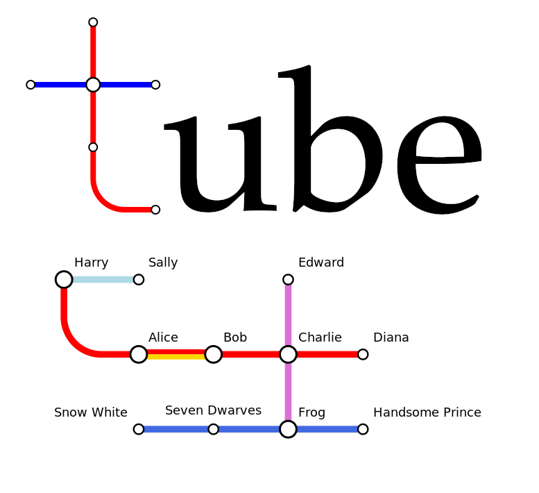

# Tube

**Tube is a simple Python program for generating schematic, topological diagrams of networks and relationships, inspired by Harry Beck's iconic map of the London Underground.**



Tube uses a short, human-readable description of *lines* and *stations* to make a file in SVG format. Although inspired by metro maps, the lines and stations can represent almost anything: people and family relationships, concepts, topics, or actual transport routes.

Tube attempts to find an attractive layout automatically. Once you have a layout you like, you can save its coordinates, edit them by hand, and use them to extend the diagram **without moving existing stations**.

## Features

- A compact text format for coloured lines and named stations.
- Automatic layout with a preference for horizontal, vertical and 45° connections.
- Shared tracks displayed as adjacent coloured bands.
- Automatic placement of stations and labels.
- Stations on more than one line (interchanges) are shown larger.
- Optional legend (`--legend`).
- Editable coordinate text files for preserving layouts and adding stations.
- Optional, rounded 90° connections between named stations.
- SVG output, suitable for further editing.

## Requirements

- Python 3
- [`svgwrite`](https://pypi.org/project/svgwrite/)
- [`networkx`](https://pypi.org/project/networkx/)

Install the dependencies with:

```bash
python3 -m pip install svgwrite networkx
```

Tube is a command-line Python script; it does not require a graphical interface.

## Quick start

Create a file called `example.tube`:

```text
# Two intersecting lines
line Smith [color=red, direction=h]
    Alice -- Bob -- Charles -- Diana;

line Jones [color=blue, direction=v]
    Edward -- Charles -- Frances -- George;
```

Run:

```bash
python3 tube.py example.tube
```

Tube creates:

- `example.svg` — the drawing.
- `example_new.coords` — the calculated station coordinates, saved as editable text.

To include a legend:

```bash
python3 tube.py example.tube --legend
```

## The `.tube` format

A line definition has the form:

```text
line LineName [color=red, direction=h]
    Station1 -- Station2 -- Station3;
```

Stations are connected in the order given. Repeating the **same station name** on another line creates an interchange.

The `color` attribute uses SVG colour names (such as `red`, `navy`, or `lightblue`) or SVG hexadecimal colours (such as `#cc3333`). The default is `black`.

The `direction` attribute gives the layout algorithm a **preference**, not a strict requirement:

| Direction | Preferred orientation |
| --- | --- |
| `h` | Horizontal |
| `v` | Vertical |
| `d` | Diagonal, slope down to the right |
| `u` | Diagonal, slope up to the right |

Whole-line comments beginning with `#` are allowed, including indented comments. Note that `#` inside a colour value is not a comment.

### Shared tracks

If two lines use the same connection between two stations, Tube recognises the shared segment even if the station order is reversed. Different route colours appear as adjacent bands rather than being painted over one another. Multiple lines of the same colour share a single band.

## Saving and reusing layouts

A coordinate file contains one station name and its X and Y coordinates per line:

```text
# Tube station coordinates
Alice       0     90
Bob        90     90
Charles   180     90
Diana     270     90
```

To reuse a layout, pass its coordinate file as the second argument:

```bash
python3 tube.py example.tube example_new.coords
```

Stations listed in that file remain **fixed**, while new stations can be positioned by the optimiser. This makes it possible to build a diagram incrementally, or manually adjust coordinates for a more carefully composed result.

The new calculation is saved to `example_new.coords`. **Back up a layout you want to retain before rerunning Tube**, because that output filename is reused. You can also give a saved layout another filename and supply that filename on the next run. Any text editor can be used to move station locations, or remove them from a coordinate file.

If no coordinate file is provided, Tube starts a fresh automatic layout. For a predictable layout, supply coordinates explicitly.

## Optional rounded bends

A `bend` directive adds a station-free rounded 90° connection between two named stations:

```text
bend Charles Diana [order=hv, color=red]
```

- `order=hv` means leave the first station horizontally and arrive at the second vertically.
- `order=vh` means leave vertically and arrive horizontally.
- `color=red` sets the connection colour explicitly. When omitted, Tube can infer a colour if the endpoints share exactly one line colour.

For example:

```text
line Red1 [color=red, direction=h]
    Alice -- Bob -- Charles;

line Red2 [color=red, direction=v]
    Diana -- Edward -- Frances;

bend Charles Diana [order=hv, color=red]
```

Bends can also introduce stations not present in ordinary line definitions. An endpoint may be positioned automatically or defined explicitly in a coordinate file. If a station name in a bend contains spaces, surround that name with quotes.

Bends are an **optional drawing aid**, rather than a full-purpose routing engine. In particular, the automatic label and collision checks are primarily designed for ordinary straight connections; a complex diagram with many arcs may benefit from manually edited coordinates.

## Command-line usage

```text
python3 tube.py file.tube [file.coords] [--legend]
```

| Argument | Meaning |
| --- | --- |
| `file.tube` | Required network description |
| `file.coords` | Optional existing coordinates, treated as fixed |
| `--legend` | Add line names and colour samples below the diagram |

The output SVG uses the same basename as the input file. Calculated positions are written to `<basename>_new.coords`.

## Working with the SVG

Tube writes out SVG rather than PNG files. SVG is a widely supported vector graphics format that can be displayed directly in web browsers and scaled without loss of quality. Tube's SVG output can be edited in Inkscape or processed by programs such as ImageMagick and GIMP. If you choose to use CairoSVG [CairoSVG](https://cairosvg.org/) for SVG conversion to PNG, please make sure to use an up-to-date version (preferably >=2.7.1). CairoSVG provides a convenient command-line utility that can be used from the command line.

```bash
python3 -m pip install cairosvg
cairosvg example.svg -o example.png -s 2
```

## How the layout works

Tube begins with an approximate arrangement based on line order and preferred directions. It then tries to improve the map using simulated annealing and local refinements. The scoring system balances several visual considerations, including station collisions, track crossings, line length, bends, geometry, and directional preferences.

The resulting diagrams are *schematic*: they are not intended to represent real distances. As with any heuristic optimiser, different networks may require different scoring weights or manual adjustments to obtain the most desirable appearance. Building a diagram up in steps, using coordinates saved from successive runs, will probably help in cases with many stations.

## License

Tube is released under the MIT License, allowing others to use, modify and redistribute the code. See [LICENSE](LICENSE).

## Project status

Tube is a small experimental utility, developed for drawing general relationship diagrams. 


